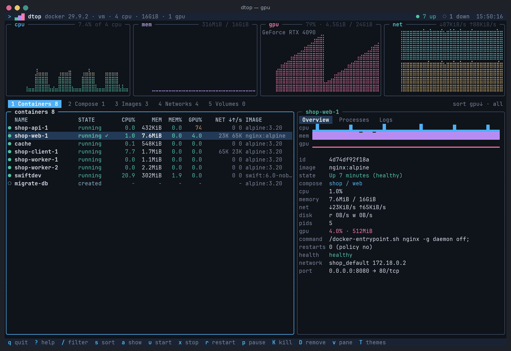
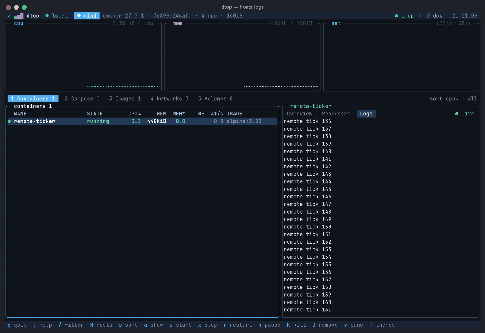

<h1 align="center">
  <picture>
    <source media="(prefers-color-scheme: dark)" srcset="docs/brand/dtop-logo-dark.svg">
    
  </picture>
</h1>

<p align="center"><strong>The modern terminal dashboard for containers.</strong></p>

`dtop` is a Swift terminal UI inspired by `btop`/`htop`, built around Docker and Docker Compose:
live resource graphs, a compose-aware container tree, per-container processes and logs, and
start/stop/restart/kill/remove/prune workflows. It runs on macOS, Linux and Windows and has no
third-party dependencies.


| Compose tree and process tree | Live logs |
| --- | --- |
|  |  |
| **Theme menu with live preview** | **Confirmation for destructive actions** |
|  |  |
| **GPU graph, per-container GPU%, sort by GPU** | |
|  | |

All screenshots are real captures of dtop against a running Docker daemon
([how they're made](scripts/screenshots/README.md)). The capture machine has no GPU, so for the GPU
screenshot `nvidia-smi` was a stand-in script. It printed nvidia-smi's real output formats and named
the real host processes of two containers. Everything after that is dtop's real code path: running
`nvidia-smi`, parsing its output, mapping processes to containers through `/proc/<pid>/cgroup`, and
rendering.

## Features

- **Real-time monitoring**: braille CPU, memory and network graphs for the whole host, plus CPU,
  memory, network and block I/O rates per container. The numbers use the same formulas as
  `docker stats`, covering cgroup v1, cgroup v2 and Windows containers.
- **Compose-first views**: containers are grouped into projects and services from their Compose
  labels. You can fold projects and see a roll-up status (running, partial, degraded, stopped).
- **GPU monitoring**: a host GPU utilization graph with memory use, plus per-container GPU%
  and GPU memory, for NVIDIA, AMD, Intel and Apple Silicon (see the feature matrix for what
  each vendor supports). The details panel also shows which GPUs a container may access
  (`--gpus`, `/dev/dri`, `/dev/kfd`). Turn it off with `--no-gpu`.
- **Process trees**: the `docker top` output for each container, shown as a PID/PPID tree.
- **Live logs**: the Logs pane follows the selected container's output as it is written
  (`logs -f`), with terminal escapes stripped and stderr highlighted. It keeps the last 5,000
  lines and holds your place when you scroll back; `f` (or scrolling to the end) resumes.
  Pausing updates (space) freezes the pane too; lines that arrive meanwhile appear on resume.
- **Remote and TLS daemons**: `tcp://` and `https://` endpoints with TLS configured the way the
  Docker CLI does it (`--tlsverify`, `DOCKER_TLS_VERIFY`, `DOCKER_CERT_PATH`, client
  certificates), plus Docker contexts. TLS uses each OS's own stack, so there are still no
  third-party dependencies.
- **Several hosts at once**: repeat `--host` or `--context` (or use `--all-contexts`). Every host
  is polled; header chips show their status, `[`/`]` switch between them and `H` lists them.
- **Management**: start, stop, restart, pause, kill and remove containers. Compose stacks get
  start/stop/restart/pause plus `up`/`down` through the Compose CLI. You can remove or prune
  images, networks and volumes. Destructive actions ask for confirmation, and **No** is focused
  by default.
- **Keyboard and mouse**: vim and arrow keys, clickable tabs, rows and panes, and wheel scrolling.
- **Themes**: ten built-in themes and a simple theme-file format. A theme menu (`T`) previews every
  change on the live UI and only keeps it if you save. Truecolor is downsampled automatically to
  256 or 16 colors, and `NO_COLOR` is honoured.
- **Low overhead**: the screen is diffed so only changed cells are redrawn. Metric history lives
  in fixed-size ring buffers, stats requests run with bounded concurrency, and the event stream
  triggers refreshes instead of tighter polling.
- **Resilient**: if the daemon goes away, dtop keeps the last known state on screen and
  reconnects with exponential backoff. Every error message says what to do next.

## Install and run

Swift 6.0 or newer is required: Xcode 16+ on macOS, or a swift.org toolchain on Linux and Windows.

```bash
swift build -c release
```

```bash
.build/release/dtop
```

For release builds, the project follows semantic-version tags like `v0.1.0`. The GitHub release
workflow stamps each build with the tag, produces archives for the supported platforms, signs the
artifacts, and publishes a GitHub Release with checksums.

### Release process

To make a tag and a local proof build on the current platform:

```bash
./scripts/release.sh 0.1.0 --tag
```

To build and sign the archive locally before pushing the tag:

```bash
./scripts/release.sh 0.1.0 --sign
```

To create and push the annotated release tag:

```bash
./scripts/release.sh 0.1.0 --tag --push
```

The GitHub Actions workflow in `.github/workflows/release.yml` performs the same version stamping,
platform builds, GPG signing, checksum generation, and GitHub Release upload automatically for
`v*.*.*` tags. On Linux, the release binary is built with the Swift runtime statically linked so the
archive is runnable on a fresh Ubuntu host without the `libswiftCore.so` dependency.

dtop finds Docker the way the Docker CLI does:

1. `--host` or `--context` (both repeatable, for several hosts)
2. `DOCKER_HOST`
3. The active Docker context (`DOCKER_CONTEXT`, or the one `docker context use` selected)
4. Well-known sockets:
   - Linux: `/var/run/docker.sock`, then rootless `$XDG_RUNTIME_DIR/docker.sock`
   - macOS: Docker Desktop, OrbStack, Colima and Rancher Desktop sockets
   - Windows: the `\\.\pipe\docker_engine` named pipe

Supported endpoint forms are `unix://`, `npipe://`, `tcp://` (plain or TLS) and `https://`
(TLS). For `ssh://` hosts, forward the socket first
(`ssh -NL /tmp/docker.sock:/var/run/docker.sock host`) and use `unix:///tmp/docker.sock`.

```text
dtop [options]
  -H, --host [name=]<endpoint>
                            unix:///var/run/docker.sock, npipe:////./pipe/docker_engine,
                            tcp://host:2375, https://host:2376 (repeat for several hosts)
      --context <name>      a Docker context (repeatable); --all-contexts for every one
      --tls / --tlsverify   TLS without / with verifying the daemon
      --tlscacert / --tlscert / --tlskey <file>
                            CA, client certificate and key (default ~/.docker/{ca,cert,key}.pem)
  -i, --interval <seconds>  refresh interval, 0.25-60 (default 2; accepts 500ms)
  -t, --theme <name|file>   built-in theme name or path to a .theme file
      --color <mode>        auto, truecolor, 256, 16 or none
      --running             only list running containers
      --sort <key>          name, cpu, memory, gpu, status, created, image
      --no-mouse            disable mouse reporting
      --no-gpu              don't collect GPU metrics
      --history <samples>   samples kept per graph (30-3600)
  -c, --config <file>       settings file (default: see below)
      --once                print one plain-text snapshot and exit (scriptable)
      --list-themes / --print-theme <name>
  -h, --help / -v, --version
```

`dtop --once` prints a plain table with CPU% measured over one second. It works without a TTY, so
you can use it in scripts and CI. With several hosts it prints one `== name ==` section per host
and exits with status 1 if any host could not be reached.

## Remote hosts, TLS and contexts

### TLS

dtop reads the same settings as the Docker CLI, so a shell that already works with `docker` works
with dtop:

```bash
DOCKER_HOST=tcp://prod.example.com:2376 DOCKER_TLS_VERIFY=1 DOCKER_CERT_PATH=/path/to/certs dtop
```

```bash
dtop --host tcp://prod.example.com:2376 --tlsverify --tlscacert ca.pem --tlscert cert.pem --tlskey key.pem
```

- `--tlsverify` (or `DOCKER_TLS_VERIFY=1`) encrypts and checks the daemon's certificate and name,
  against `--tlscacert` if given (only that CA is trusted), else `ca.pem` in `DOCKER_CERT_PATH`
  or `~/.docker`, else the system's trusted roots.
- `--tls` (or `DOCKER_TLS=1`, or an `https://` address) encrypts without verifying the daemon,
  like the Docker CLI's `--tls`.
- A client certificate is used when `cert.pem` and `key.pem` are present (or `--tlscert` and
  `--tlskey` are given). Keys may be RSA or ECDSA (P-256/384/521) in PKCS#1, SEC1 or PKCS#8 PEM;
  encrypted keys are not supported.
- TCP addresses without a port use 2376 with TLS and 2375 without.
- Errors say what to change: an untrusted CA, a certificate for another name, a daemon that wants
  a client certificate (or rejected yours), or a port that doesn't speak TLS.

TLS runs on each platform's own stack, with no extra dependencies:

| Platform | TLS stack | Notes |
| --- | --- | --- |
| Linux | OpenSSL 1.1.1 or 3.x, loaded at runtime | `libssl` must be installed (it is on virtually every distribution) |
| macOS | Network.framework | Client certificates are used from the PEM files in memory; nothing goes into the keychain |
| Windows | SChannel | TLS 1.3 on Windows 11 and Server 2022, else 1.2 (Windows before 10 1809 is limited to 1.2). Client keys are imported into your CNG key store for the session and deleted when dtop exits |

### Docker contexts

With no `--host` and no `DOCKER_HOST`, dtop uses the active Docker context, including its TLS
material. `--context prod` picks one explicitly, and `--all-contexts` monitors every context (plus
`default`). Contexts with `ssh://` endpoints are skipped with a notice.

### Several hosts

```bash
dtop --host local=unix:///var/run/docker.sock --host prod=tcp://prod.example.com:2376 --tlsverify
```

- Every host is polled; the header shows a chip per host with its status (● connected,
  ○ connecting, ✕ offline). Click a chip, press `[`/`]`, or press `H` for a list with each host's
  containers, CPU, memory and endpoint.
- Lists, graphs, details, logs and management actions apply to the host on screen. Compose
  commands get that host's `--context`, or `--host` plus TLS flags.
- GPU usage is measured on this machine, so it is shown for the first local host.
- TLS flags on the command line apply to every TCP host. Per-host settings go in `dtop.conf`
  (below).



## Keys

| Keys | Action |
| --- | --- |
| `↑↓` `j` `k`, `PgUp` `PgDn`, `g` `G` | move the selection |
| `←→` `Tab` `h` `l`, `1`–`5` | switch view (containers, compose, images, networks, volumes) |
| `Enter` / `d` / `v` | toggle details (Enter folds a compose project) / toggle details / cycle the overview, processes and logs panes |
| `/` | filter (`Esc` clears, `Ctrl-U` and `Ctrl-W` edit, paste works) |
| `s` / `S` / `a` | sort key / sort direction / all, running or stopped |
| `u` `x` `r` `p` `K` `D` | start/unpause, stop, restart, pause/unpause, kill, remove |
| `U` / `D` on a project | `docker compose up -d` / `docker compose down` |
| `X` | prune the current view's resource type |
| `T` or `F2` | theme menu: edit with live preview, `s` to save, `Esc` to discard |
| `[` `]` / `H` | previous / next host / host list (with several hosts; `1`–`9` pick from the list) |
| `f` | follow or pause the log stream (Logs pane) |
| `t` / `space` / `R` | cycle theme for this session (not saved) / pause updates / refresh now |
| `?` / `q` `Ctrl-C` | help / quit |

**Mouse** (on by default; `--no-mouse` turns it off):

| Action | Effect |
| --- | --- |
| Click a tab, a row, or a details pane label | switch view / select the row / switch pane |
| Click an already-selected Compose project | fold or unfold it |
| Wheel over the list / over the details panel | move the selection / scroll the panel (in Logs, wheel-up goes back in time and pauses following; scrolling to the end resumes) |
| Click a host chip in the header, or a row of the host list | switch to that host |
| Click **Yes** / **No** in a confirmation | confirm / cancel |
| Click anywhere while help is open | close help |

Press `?` inside dtop for the same reference:


## Configuration

Settings are read from `dtop.conf` in `$XDG_CONFIG_HOME/dtop`, `~/.config/dtop`, or
`%APPDATA%\dtop` on Windows. Command-line flags override the file.

```ini
# dtop.conf
interval = 1s
theme = midnight
color = auto
mouse = true
show_stopped = true
sort = cpu
history = 600
gpu = true

# Hosts (optional; the default is DOCKER_HOST, the active context, or the local socket).
# Global TLS keys apply to every TCP host: tls, tlsverify, tlscacert, tlscert, tlskey, cert_path.
tlsverify = true
host = local=unix:///var/run/docker.sock
context = staging
all_contexts = false

# One section per host for per-host settings; section keys override the global ones.
[host prod]
endpoint = tcp://prod.example.com:2376
cert_path = /home/me/.docker/prod
```

Sections come after the global settings. Hosts on the command line replace the file's hosts.

## Themes


The built-in themes are `harbor` (the default), `daylight`, `midnight`, `ember`, `forest`,
`glacier`, `dusk`, `contrast`, `ansi` (follows your terminal's 16-color palette) and `monochrome`
(no color, uses reverse video). `daylight` and `glacier` are made for light terminal backgrounds,
and `contrast` maximizes legibility. Run `dtop --list-themes` to see them all, including your own.

### Theme menu

Press `T` (or `F2`) to open the theme menu. While it is open, the whole UI renders with your
draft, so you see every change on real data as you make it.

| Keys | Action |
| --- | --- |
| `↑↓` `j` `k`, wheel, click | pick a row: base theme, borders, emphasis, or any of the 36 color roles |
| `←→` (`Shift` or `H`/`L` for big steps) | change the value; on a color row, nudge the selected R/G/B channel |
| `Tab` / `Shift-Tab` | switch between the R, G and B channels |
| `Enter` | type a color: `#4fb0f5`, `#fff`, `rgb(1,2,3)`, `color(42)`, `red`, `bright-blue` or `default` |
| `d` / `r` | reset the row to the base theme / revert every change |
| `s` | save under a name (lowercase letters, digits, `-`, `_`) |
| `Esc` | close; if there are unsaved changes dtop asks before discarding them |

Saving writes `themes/<name>.theme` and sets `theme = <name>` in `dtop.conf`. It keeps the rest of
that file as it is, including comments. If you pick an unmodified built-in theme, saving only
updates `dtop.conf`. Closing without saving restores the previous theme, and nothing is written.
`t` cycles themes for the current session only.

Theme files are plain text, so you can also write them by hand. Start from a built-in theme:

```bash
dtop --print-theme harbor > ~/.config/dtop/themes/mine.theme
```

```ini
name = mine
inherits = harbor
accent = #4fb0f5
status_running = green
# border styles: rounded, single, double, heavy, ascii
border_style = rounded
```

## Architecture

| Module | Responsibility |
| --- | --- |
| `DtopCore` | Endpoint and host resolution (Docker CLI rules, contexts); transports (Unix socket and TCP on POSIX, Winsock TCP and named pipe on Windows); TLS on each platform's stack (OpenSSL, Network.framework, SChannel) with PEM/DER key handling; an incremental HTTP/1.1 client; the Docker Engine API client and models; stats math; compose grouping and CLI invocation; process trees; ring buffers; backoff |
| `DtopUI` | Colors and styles; a screen buffer with wide-character handling; the diffing renderer; layout; widgets (box, table, gauge, braille graph, sparkline); themes; the VT/mouse/paste input parser; raw-mode terminal I/O |
| `DtopApp` | Pure `AppState` and reducer (input → state + commands); the `ThemeEditor` state machine; views (including the theme menu panel); the `DataRefresher` actor; `ThemeStore` (saving themes and updating `dtop.conf`); configuration; the `--once` report; the `AppController` event loop |
| `dtop` | `main.swift`, which calls `DtopMain.run` |

Views and the reducer are pure functions of state, so they are tested without a terminal or a
daemon. The `DockerAPI` protocol lets the runtime be tested against a fake, and theme saving
takes injected file operations. The main design decisions are recorded in
[`.github/plans/0001-zero-dependency-cross-platform-architecture.md`](.github/plans/0001-zero-dependency-cross-platform-architecture.md).

## Branding


The dtop mark is a terminal prompt beside three rising metric bars, on a rounded dark tile. The
files are in [`docs/brand/`](docs/brand/):

| File | Use |
| --- | --- |
| `dtop-icon.svg` | The icon, for any size |
| `dtop-icon-{1024,512,256,128,64,32}.png` | The icon as PNGs with transparent corners (avatars, app stores, social cards) |
| `dtop-logo-dark.svg` | Icon and wordmark for dark backgrounds |
| `dtop-logo-light.svg` | Icon and wordmark for light backgrounds |

| Color | Hex | In the mark |
| --- | --- | --- |
| Accent blue | `#4fa3e8` | Prompt chevron and baseline |
| Green | `#4fd18b` | Short bar |
| Purple | `#b58af0` | Middle bar |
| Pink | `#f0679a` | Tall bar |
| Tile | `#111823`, border `#2a3a52` | Background tile |
| Ink / paper | `#0a0e14` / `#f2f6fb` | Wordmark on light / dark backgrounds |

The wordmark is JetBrains Mono ExtraBold (SIL Open Font License), converted to outlines so the
SVGs need no font. In the terminal, dtop draws the mark itself: `> ▃▅▇` in the header, and a
larger block-character version while it connects to Docker or waits to reconnect. It uses the
active theme's accent, success, memory and gpu colors, so the mark follows your theme.
`scripts/brand/build.py` regenerates every file in `docs/brand/` (`--png` also renders the PNGs
with Playwright).

## Development

```bash
swift build
```

```bash
swift test
```

```bash
DTOP_INTEGRATION=1 swift test --filter Integration
```

```bash
swift run dtop
```

`swift test` runs the full unit suite and needs no Docker daemon. The integration suite needs a
reachable daemon. It creates labelled `alpine` containers and removes them afterwards.

CI runs on every PR and push to `main`:

- **Linux, macOS, Windows**: build, unit tests, and smoke tests of the executable.
- **Linux only**:
  - The unit tests again with 512 KB thread stacks. macOS gives secondary threads 512 KB, so this catches debug-build stack overflows that Linux's 8 MB default would hide.
  - The integration suite and `dtop --once`, against the runner's Docker daemon.

To regenerate the screenshots in `docs/screenshots/`, see
[`scripts/screenshots/README.md`](scripts/screenshots/README.md). To regenerate the logo and icon
files in `docs/brand/`, run `python3 scripts/brand/build.py --png`.

## Feature matrix

What works on each platform, and how it has been verified so far. ✓ = supported, ✗ = not
supported yet, — = not applicable.

| Feature | macOS | Linux | Windows | Verified by |
| --- | :-: | :-: | :-: | --- |
| Connect over a Unix socket | ✓ | ✓ | — | unit · real-socket test (macOS/Linux CI) · integration · e2e |
| Connect over a named pipe (Docker Desktop) | — | — | ✓ | unit (Windows CI) |
| Connect over plain-HTTP `tcp://` | ✓ | ✓ | ✓ | unit (Winsock connect/failure on Windows CI) · e2e |
| TLS 1.2 and 1.3 (`--tlsverify`, `--tls`, `https://`, client certificates) | ✓ ⁶ | ✓ ⁶ | ✓ ⁶ | real handshakes against `openssl s_server` on all three CI runners, including TLS 1.3-only and 1.2-only servers · `--once` against a `--tlsverify` docker:dind daemon (Linux CI) · e2e |
| `ssh://` endpoints | ✗ | ✗ | ✗ | forward the socket first (see above) |
| Endpoint discovery (`DOCKER_HOST`, Docker contexts, well-known sockets) | ✓ | ✓ | ✓ | unit (contexts laid out as the Docker CLI writes them) |
| Several hosts at once (chips, `[` `]`, host list, `--once` sections) | ✓ | ✓ | ✓ | unit · e2e (local socket + TLS daemon) · CI `--once` with two daemons |
| Host CPU / memory / network graphs, per-container rates | ✓ | ✓ | ✓ | unit · integration · e2e |
| Stats math for cgroup v1, cgroup v2 and Windows containers | ✓ | ✓ | ✓ | unit (real payload fixtures) |
| Compose project tree and roll-up status | ✓ | ✓ | ✓ | unit · e2e |
| Process tree (`docker top`) | ✓ | ✓ | ✓ | unit · integration · e2e |
| Logs pane (stdout/stderr, escapes stripped) | ✓ | ✓ | ✓ | unit · integration · e2e |
| Live log streaming (`logs -f`), follow/pause, reconnect | ✓ | ✓ | ✓ | unit (mock daemon, stream policy) · e2e (local and over TLS) |
| Container start / stop / restart / pause / kill / remove | ✓ | ✓ | ✓ | unit · integration · e2e |
| Compose start / stop / restart / pause | ✓ | ✓ | ✓ | unit |
| Compose `up` / `down` (needs the `docker compose` CLI on `PATH`) | ✓ | ✓ | ✓ | unit (command building) |
| Images / networks / volumes: list, remove, prune | ✓ | ✓ | ✓ | unit · integration (listing) |
| Filter, sort, running/stopped filter | ✓ | ✓ | ✓ | unit · e2e |
| Mouse (SGR reporting, split reports over SSH) | ✓ | ✓ | ✓ | unit · e2e |
| 10 themes, theme menu with live preview, save/revert | ✓ | ✓ | ✓ | unit · e2e |
| Truecolor → 256 → 16-color fallback, `NO_COLOR` | ✓ | ✓ | ✓ | unit |
| GPU graph + per-container GPU%: NVIDIA (`nvidia-smi`) | — | ✓ | host graph only ¹ | unit · e2e (stand-in `nvidia-smi`) |
| GPU graph + per-container GPU%: AMD (amdgpu sysfs + DRM fdinfo) | — | ✓ ² | ✗ | unit (kernel-format fixtures) |
| GPU graph + per-container GPU%: Intel (DRM fdinfo, i915 and xe) | — | ✓ ² | ✗ | unit (kernel-documented examples) |
| GPU graph: Apple Silicon (IOKit `IOAccelerator`) | host graph only ³ | — | — | unit (parser); IOKit code builds in macOS CI |
| Config file location | `~/.config/dtop` | `$XDG_CONFIG_HOME/dtop` or `~/.config/dtop` | `%APPDATA%\dtop` | unit |
| `dtop --once` plain-text report | ✓ | ✓ | ✓ | CI against a real daemon (Linux) |
| Reconnect with backoff when the daemon goes away | ✓ | ✓ | ✓ | unit |

GPU notes:

1. On Windows, containers run inside Docker Desktop's VM, so GPU work can't be attributed to
   individual containers. AMD and Intel on Windows are not supported yet; they would need Windows
   performance counters.
2. Per-container AMD/Intel usage is read from other processes' `/proc/<pid>/fdinfo`, which needs
   root. Without root, dtop still shows the GPU graph and says in the GPU box why per-container
   values are missing. AMD's `rocm_smi_lib` isn't used: it is in maintenance mode (critical
   fixes only since ROCm 7.0), and both it and its successor AMD SMI read the same amdgpu sysfs
   counters dtop reads directly. See [ADR 0002](.github/plans/0002-gpu-monitoring-sources.md).
3. macOS shows the Mac's own GPU. Containers on macOS run in Docker Desktop's Linux VM, which
   has no GPU access, so there is nothing to attribute per container. The `IOAccelerator`
   statistics are undocumented, so missing values show as unknown.
4. Per-container attribution only works when dtop runs on the Docker host itself (same PID
   namespace). It does not work when dtop connects to a remote daemon.
5. None of this has been tested on real GPU hardware yet; this environment has no GPU.
6. Linux uses OpenSSL (loaded at runtime), macOS Network.framework, Windows SChannel. All three
   negotiate TLS 1.3 where the OS supports it (Windows 11 / Server 2022) and fall back to 1.2.
   See [ADR 0003](.github/plans/0003-tls-on-platform-stacks.md).

What the verification labels mean:

- **unit**: the 530-test suite (531 on Windows), run in CI on all three platforms (TLS tests included, against a real `openssl s_server`).
- **integration**: tests against a real Docker daemon on the Linux CI runner.
- **e2e**: the real app driven in a pseudo-terminal against live daemons (including a `--tlsverify` docker:dind daemon for multi-host and TLS log streaming): real key and mouse input, with the rendered screen checked cell by cell. So far this has only been run on Linux.

**Not verified yet:** hands-on use in real macOS and Windows terminals (Terminal.app, iTerm2,
Windows Terminal), and Windows against a live Docker Desktop. On those platforms the code builds and
the unit tests pass, but nobody has driven the app interactively there yet.

### Platform notes

- **Windows**: dtop talks to Docker Desktop over its named pipe, or to `tcp://` daemons over
  Winsock, and needs a VT-capable console (Windows Terminal, or Windows 10 1809 or newer). With a
  TLS client certificate, the key is imported into your CNG key store as `dtop-<uuid>` and
  deleted when dtop exits. If dtop is killed, list leftovers with
  `certutil -csp "Microsoft Software Key Storage Provider" -key` and remove them with
  `certutil -csp "Microsoft Software Key Storage Provider" -delkey dtop-<uuid>`.
- **Linux**: TLS needs `libssl` 1.1.1 or 3.x (`libssl3`, `openssl-libs`).
- **macOS**: when `DOCKER_HOST` is unset, dtop finds the Docker Desktop, OrbStack, Colima and
  Rancher Desktop sockets automatically.
