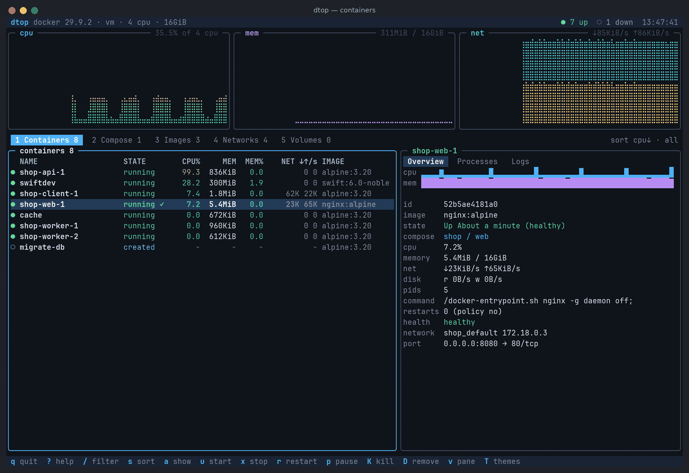
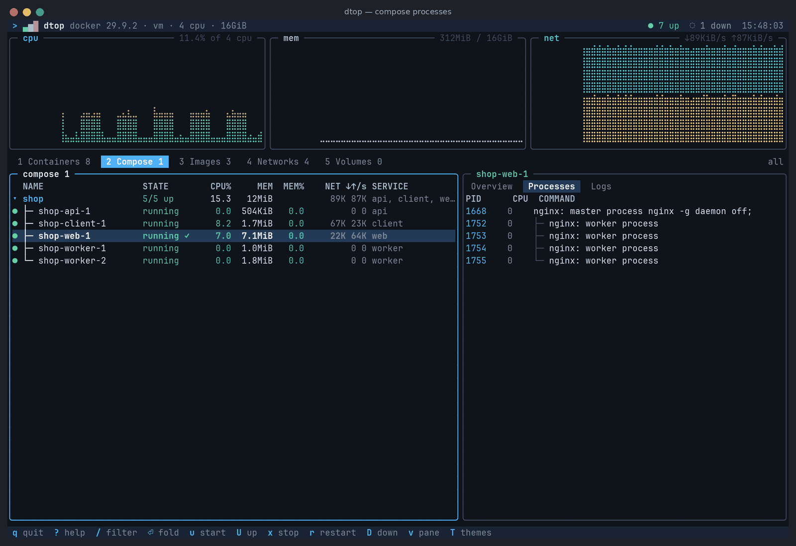
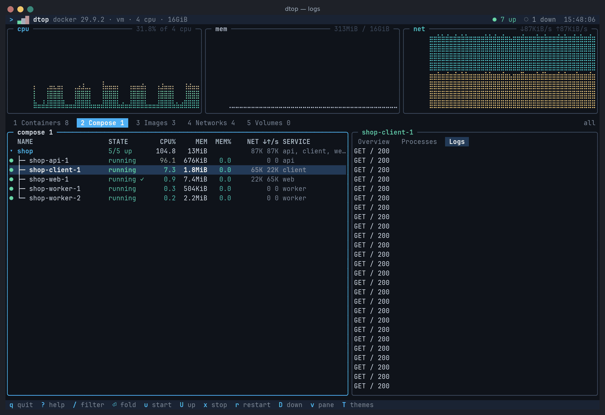
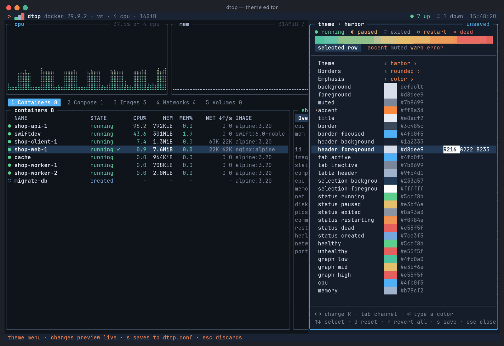
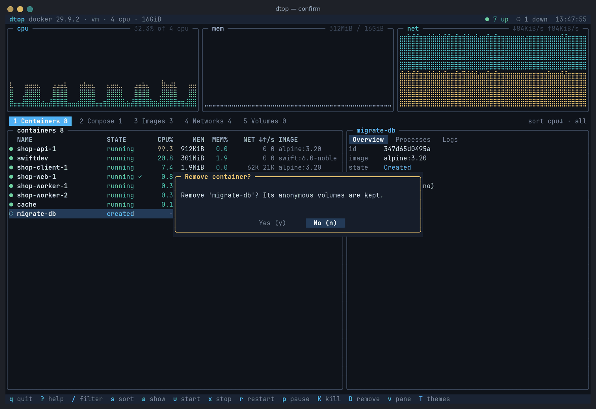
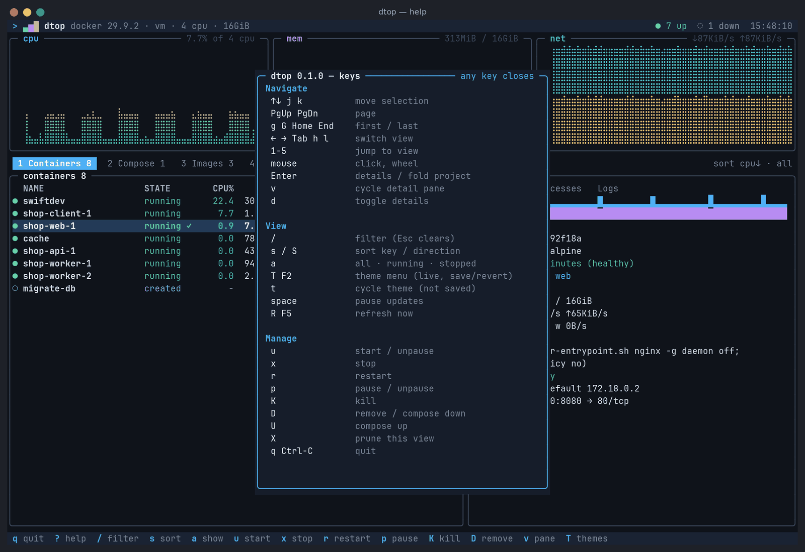
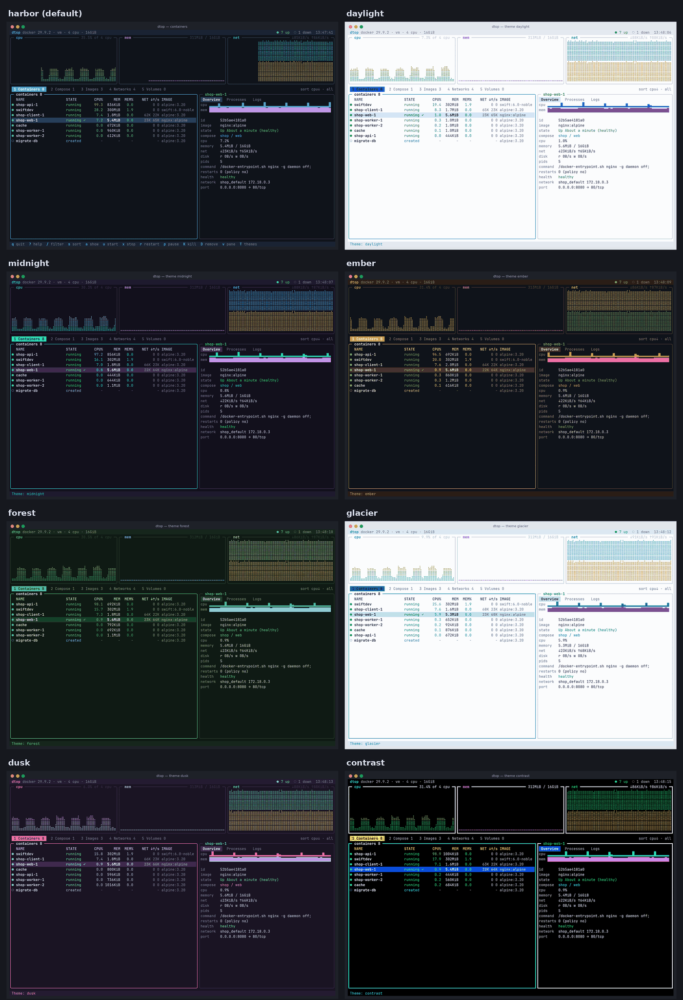

# dtop

`dtop` is a Swift terminal UI inspired by `btop`/`htop`, built around Docker and Docker Compose:
live resource graphs, a compose-aware container tree, per-container processes and logs, and
start/stop/restart/kill/remove/prune workflows. It runs on macOS, Linux and Windows and has no
third-party dependencies.



| Compose tree and process tree | Live logs |
| --- | --- |
|  |  |
| **Theme menu with live preview** | **Confirmation for destructive actions** |
|  |  |

All screenshots are real captures of dtop against a running Docker daemon
([how they're made](scripts/screenshots/README.md)).

## Features

- **Real-time monitoring**: braille CPU, memory and network graphs for the whole host, plus CPU,
  memory, network and block I/O rates per container. The numbers use the same formulas as
  `docker stats`, covering cgroup v1, cgroup v2 and Windows containers.
- **Compose-first views**: containers are grouped into projects and services from their Compose
  labels. You can fold projects and see a roll-up status (running, partial, degraded, stopped).
- **Process trees**: the `docker top` output for each container, shown as a PID/PPID tree.
- **Logs**: the stdout/stderr tail with terminal escapes stripped and stderr highlighted.
- **Management**: start, stop, restart, pause, kill and remove containers. Compose stacks get
  start/stop/restart/pause plus `up`/`down` through the Compose CLI. You can remove or prune
  images, networks and volumes. Destructive actions ask for confirmation, and **No** is focused
  by default.
- **Keyboard and mouse**: vim and arrow keys, clickable tabs, rows and panes, and wheel scrolling.
- **Themes**: ten built-in themes and a simple theme-file format. A theme menu (`T`) previews every
  change on the live UI and only keeps it if you save. Truecolor is downsampled automatically to
  256 or 16 colors, and `NO_COLOR` is honoured.
- **Low overhead**: the screen is diffed so only changed cells are redrawn. Metric history lives
  in fixed-size ring buffers, stats requests run with bounded concurrency, and the event stream
  triggers refreshes instead of tighter polling.
- **Resilient**: if the daemon goes away, dtop keeps the last known state on screen and
  reconnects with exponential backoff. Every error message says what to do next.

## Install and run

Swift 6.0 or newer is required: Xcode 16+ on macOS, or a swift.org toolchain on Linux and Windows.

```bash
swift build -c release
```

```bash
.build/release/dtop
```

dtop finds Docker in this order:

1. `--host`
2. `DOCKER_HOST`
3. Well-known sockets:
   - Linux: `/var/run/docker.sock`, then rootless `$XDG_RUNTIME_DIR/docker.sock`
   - macOS: Docker Desktop, OrbStack, Colima and Rancher Desktop sockets
   - Windows: the `\\.\pipe\docker_engine` named pipe

Supported endpoint forms are `unix://`, `npipe://` and plain-HTTP `tcp://`. For `ssh://` or TLS
endpoints, forward the socket locally first.

```text
dtop [options]
  -H, --host <endpoint>     unix:///var/run/docker.sock, npipe:////./pipe/docker_engine, tcp://host:2375
  -i, --interval <seconds>  refresh interval, 0.25-60 (default 2; accepts 500ms)
  -t, --theme <name|file>   built-in theme name or path to a .theme file
      --color <mode>        auto, truecolor, 256, 16 or none
      --running             only list running containers
      --sort <key>          name, cpu, memory, status, created, image
      --no-mouse            disable mouse reporting
      --history <samples>   samples kept per graph (30-3600)
  -c, --config <file>       settings file (default: see below)
      --once                print one plain-text snapshot and exit (scriptable)
      --list-themes / --print-theme <name>
  -h, --help / -v, --version
```

`dtop --once` prints a plain table with CPU% measured over one second. It works without a TTY, so
you can use it in scripts and CI.

## Keys

| Keys | Action |
| --- | --- |
| `↑↓` `j` `k`, `PgUp` `PgDn`, `g` `G` | move the selection |
| `←→` `Tab` `h` `l`, `1`–`5` | switch view (containers, compose, images, networks, volumes) |
| `Enter` / `d` / `v` | toggle details (Enter folds a compose project) / toggle details / cycle the overview, processes and logs panes |
| `/` | filter (`Esc` clears, `Ctrl-U` and `Ctrl-W` edit, paste works) |
| `s` / `S` / `a` | sort key / sort direction / all, running or stopped |
| `u` `x` `r` `p` `K` `D` | start/unpause, stop, restart, pause/unpause, kill, remove |
| `U` / `D` on a project | `docker compose up -d` / `docker compose down` |
| `X` | prune the current view's resource type |
| `T` or `F2` | theme menu: edit with live preview, `s` to save, `Esc` to discard |
| `t` / `space` / `R` | cycle theme for this session (not saved) / pause updates / refresh now |
| `?` / `q` `Ctrl-C` | help / quit |

**Mouse** (on by default; `--no-mouse` turns it off):

| Action | Effect |
| --- | --- |
| Click a tab, a row, or a details pane label | switch view / select the row / switch pane |
| Click an already-selected Compose project | fold or unfold it |
| Wheel over the list / over the details panel | move the selection / scroll the panel (in Logs, wheel-up goes back in time) |
| Click **Yes** / **No** in a confirmation | confirm / cancel |
| Click anywhere while help is open | close help |

Press `?` inside dtop for the same reference:



## Configuration

Settings are read from `dtop.conf` in `$XDG_CONFIG_HOME/dtop`, `~/.config/dtop`, or
`%APPDATA%\dtop` on Windows. Command-line flags override the file.

```ini
# dtop.conf
host = unix:///var/run/docker.sock
interval = 1s
theme = midnight
color = auto
mouse = true
show_stopped = true
sort = cpu
history = 600
```

## Themes



The built-in themes are `harbor` (the default), `daylight`, `midnight`, `ember`, `forest`,
`glacier`, `dusk`, `contrast`, `ansi` (follows your terminal's 16-color palette) and `monochrome`
(no color, uses reverse video). `daylight` and `glacier` are made for light terminal backgrounds,
and `contrast` maximizes legibility. Run `dtop --list-themes` to see them all, including your own.

### Theme menu

Press `T` (or `F2`) to open the theme menu. While it is open, the whole UI renders with your
draft, so you see every change on real data as you make it.

| Keys | Action |
| --- | --- |
| `↑↓` `j` `k`, wheel, click | pick a row: base theme, borders, emphasis, or any of the 35 color roles |
| `←→` (`Shift` or `H`/`L` for big steps) | change the value; on a color row, nudge the selected R/G/B channel |
| `Tab` / `Shift-Tab` | switch between the R, G and B channels |
| `Enter` | type a color: `#4fb0f5`, `#fff`, `rgb(1,2,3)`, `color(42)`, `red`, `bright-blue` or `default` |
| `d` / `r` | reset the row to the base theme / revert every change |
| `s` | save under a name (lowercase letters, digits, `-`, `_`) |
| `Esc` | close; if there are unsaved changes dtop asks before discarding them |

Saving writes `themes/<name>.theme` and sets `theme = <name>` in `dtop.conf`. It keeps the rest of
that file as it is, including comments. If you pick an unmodified built-in theme, saving only
updates `dtop.conf`. Closing without saving restores the previous theme, and nothing is written.
`t` cycles themes for the current session only.

Theme files are plain text, so you can also write them by hand. Start from a built-in theme:

```bash
dtop --print-theme harbor > ~/.config/dtop/themes/mine.theme
```

```ini
name = mine
inherits = harbor
accent = #4fb0f5
status_running = green
# border styles: rounded, single, double, heavy, ascii
border_style = rounded
```

## Architecture

| Module | Responsibility |
| --- | --- |
| `DtopCore` | Endpoint resolution; transports (Unix socket and TCP on POSIX, named pipe on Windows); an incremental HTTP/1.1 client; the Docker Engine API client and models; stats math; compose grouping and CLI invocation; process trees; ring buffers; backoff |
| `DtopUI` | Colors and styles; a screen buffer with wide-character handling; the diffing renderer; layout; widgets (box, table, gauge, braille graph, sparkline); themes; the VT/mouse/paste input parser; raw-mode terminal I/O |
| `DtopApp` | Pure `AppState` and reducer (input → state + commands); the `ThemeEditor` state machine; views (including the theme menu panel); the `DataRefresher` actor; `ThemeStore` (saving themes and updating `dtop.conf`); configuration; the `--once` report; the `AppController` event loop |
| `dtop` | `main.swift`, which calls `DtopMain.run` |

Views and the reducer are pure functions of state, so they are tested without a terminal or a
daemon. The `DockerAPI` protocol lets the runtime be tested against a fake, and theme saving
takes injected file operations. The main design decisions are recorded in
[`.github/plans/0001-zero-dependency-cross-platform-architecture.md`](.github/plans/0001-zero-dependency-cross-platform-architecture.md).

## Development

```bash
swift build
```

```bash
swift test
```

```bash
DTOP_INTEGRATION=1 swift test --filter Integration
```

```bash
swift run dtop
```

`swift test` runs the full unit suite and needs no Docker daemon. The integration suite needs a
reachable daemon. It creates labelled `alpine` containers and removes them afterwards.

CI runs on every PR and push to `main`:

- **Linux, macOS, Windows**: build, unit tests, and smoke tests of the executable.
- **Linux only**:
  - The unit tests again with 512 KB thread stacks. macOS gives secondary threads 512 KB, so this catches debug-build stack overflows that Linux's 8 MB default would hide.
  - The integration suite and `dtop --once`, against the runner's Docker daemon.

To regenerate the screenshots in `docs/screenshots/`, see
[`scripts/screenshots/README.md`](scripts/screenshots/README.md).

## Feature matrix

What works on each platform, and how it has been verified so far. ✓ = supported, ✗ = not
supported yet, — = not applicable.

| Feature | macOS | Linux | Windows | Verified by |
| --- | :-: | :-: | :-: | --- |
| Connect over a Unix socket | ✓ | ✓ | — | unit · real-socket test (macOS/Linux CI) · integration · e2e |
| Connect over a named pipe (Docker Desktop) | — | — | ✓ | unit (Windows CI) |
| Connect over plain-HTTP `tcp://` | ✓ | ✓ | ✗ | unit |
| TLS `tcp://` and `ssh://` endpoints | ✗ | ✗ | ✗ | planned: forward the socket locally for now |
| Automatic endpoint discovery (`DOCKER_HOST`, well-known sockets) | ✓ | ✓ | ✓ | unit |
| Host CPU / memory / network graphs, per-container rates | ✓ | ✓ | ✓ | unit · integration · e2e |
| Stats math for cgroup v1, cgroup v2 and Windows containers | ✓ | ✓ | ✓ | unit (real payload fixtures) |
| Compose project tree and roll-up status | ✓ | ✓ | ✓ | unit · e2e |
| Process tree (`docker top`) | ✓ | ✓ | ✓ | unit · integration · e2e |
| Logs pane (stdout/stderr, escapes stripped) | ✓ | ✓ | ✓ | unit · integration · e2e |
| Container start / stop / restart / pause / kill / remove | ✓ | ✓ | ✓ | unit · integration · e2e |
| Compose start / stop / restart / pause | ✓ | ✓ | ✓ | unit |
| Compose `up` / `down` (needs the `docker compose` CLI on `PATH`) | ✓ | ✓ | ✓ | unit (command building) |
| Images / networks / volumes: list, remove, prune | ✓ | ✓ | ✓ | unit · integration (listing) |
| Filter, sort, running/stopped filter | ✓ | ✓ | ✓ | unit · e2e |
| Mouse (SGR reporting, split reports over SSH) | ✓ | ✓ | ✓ | unit · e2e |
| 10 themes, theme menu with live preview, save/revert | ✓ | ✓ | ✓ | unit · e2e |
| Truecolor → 256 → 16-color fallback, `NO_COLOR` | ✓ | ✓ | ✓ | unit |
| Config file location | `~/.config/dtop` | `$XDG_CONFIG_HOME/dtop` or `~/.config/dtop` | `%APPDATA%\dtop` | unit |
| `dtop --once` plain-text report | ✓ | ✓ | ✓ | CI against a real daemon (Linux) |
| Reconnect with backoff when the daemon goes away | ✓ | ✓ | ✓ | unit |

What the verification labels mean:

- **unit**: the 393-test suite, run in CI on all three platforms.
- **integration**: tests against a real Docker daemon on the Linux CI runner.
- **e2e**: the real app driven in a pseudo-terminal against a live daemon: real key and mouse input, with the rendered screen checked cell by cell. So far this has only been run on Linux.

**Not verified yet:** hands-on use in real macOS and Windows terminals (Terminal.app, iTerm2,
Windows Terminal), and Windows against a live Docker Desktop. On those platforms the code builds and
the unit tests pass, but nobody has driven the app interactively there yet.

### Platform notes

- **Windows**: dtop talks to Docker Desktop over its named pipe and needs a VT-capable console
  (Windows Terminal, or Windows 10 1809 or newer). `tcp://` endpoints are not supported on
  Windows yet.
- **macOS**: when `DOCKER_HOST` is unset, dtop finds the Docker Desktop, OrbStack, Colima and
  Rancher Desktop sockets automatically.
